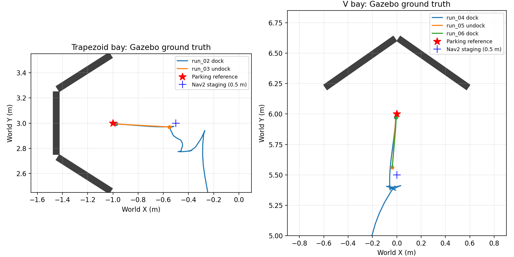

# Seggy Nav2 docking simulation — 2026-11-07

Persistent integration: articubot_one/robots/seggy/config/docking_sim.yaml and docking_nav2.yaml.
Standard navigation settings are merged at launch; no manually maintained full Nav2 snapshot.

| Run | Action / bay | Result | Retries | Settled position error | Settled heading error |
|---|---|---|---:|---:|---:|
| run_01 | trapezoid_bay | Failed: Failed dock detection | 3 | — | — |
| run_02 | trapezoid_bay | Success | 1 | 2.68 cm | 3.26 degrees |
| run_03 | undock | Success | — | — | — |
| run_04 | v_bay | Success | 0 | 2.94 cm | 4.05 degrees |
| run_05 | undock | Success | — | — | — |
| run_06 | v_bay | Success | 0 | 2.92 cm | 2.61 degrees |

Run 01 used the initial 0.8 m staging offset. Detection gaps exceeded the unchanged 0.5 s freshness limit; retries exhausted and all pipeline commands stopped. Its in-process truth reader failed on a protobuf integer string; a separate ground_truth.jsonl capture is retained, and no settled accuracy is claimed for this run. The trial recorder was fixed before subsequent runs.

The user restarted Seggy simulation before run 02. All later runs use 0.5 m staging; floor crosses remain 0.8 m references. Run 02 succeeded with one retry. Nav2 staging uses the pre-existing 0.3 m general goal tolerance, so staging can leave lateral error and initial acquisition is not guaranteed; navigation tolerances were preserved.

Pose errors use independent Gazebo world poses after a two-second settling window, relative to world parking references (-1,3,0) and (0,6,-pi/2). Nav2 success is its inherited XY-only dock threshold; it is not proof of charging, contact, or a yaw/dwell criterion. Odometry/map estimates differ from world truth.

cmd_vel_raw, cmd_vel_smoothed, cmd_vel_nav and diff_cont/cmd_vel were recorded. Every completed trial ended with zero commands on all four topics. Gazebo poses show post-result coasting, so result-time pose is not treated as settled pose.

71 unit/launch/geometry/controller tests passed, including namespace-default and preserved navigation settings checks. Nav2 plugin lifecycle/identity tests were performed in the previous named-nav2 result set. No Nav2 source changes, package installations or charging hardware changes.

During navigation reload, both the original standard Nav2 container and the docking-enabled container exited with code -6 on shutdown; the latter logged an invalid-pointer/class-loader error. This shutdown issue was not diagnosed or fixed. The subsequent normal full-simulation restart loaded and activated the docking stack successfully. No runtime crash occurred during the recorded actions.

Reproduce one action with commission.py --dock trapezoid_bay, --dock v_bay or --undock after sourcing ROS/overlays. The script commands real ROS actions in the current domain: use only with the intended simulation. Re-running report.py rewrites analysis.json and trajectories.png.
